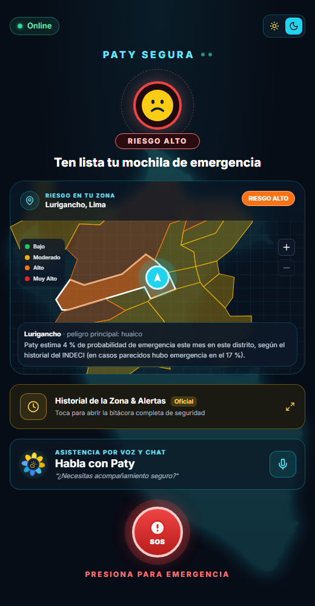
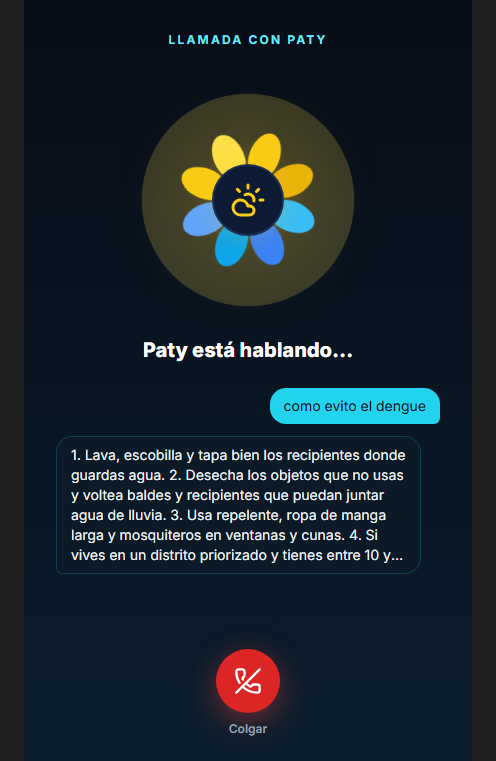
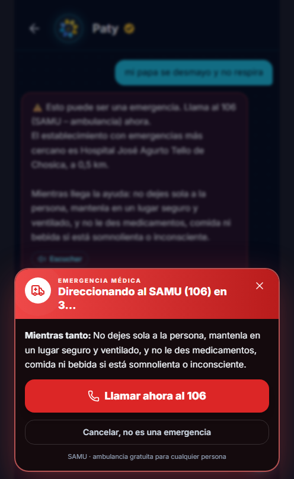
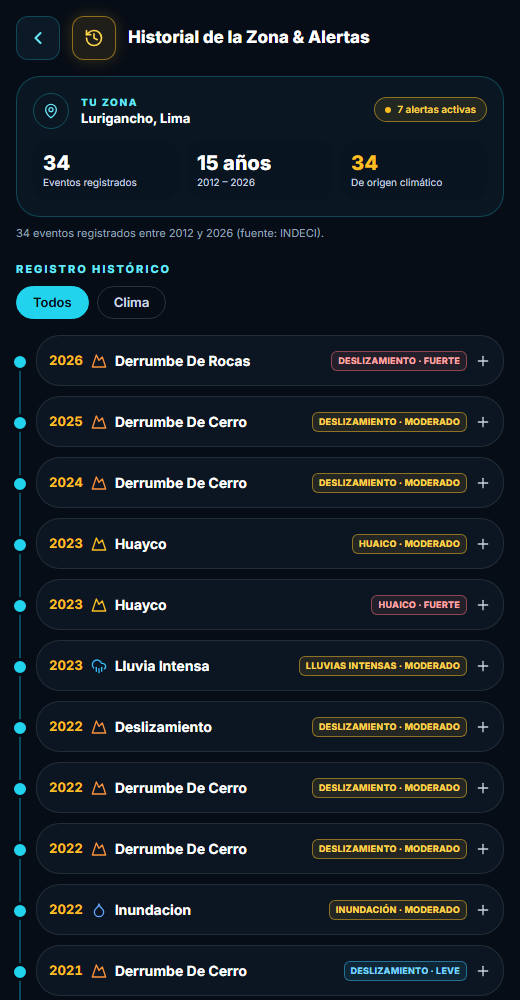
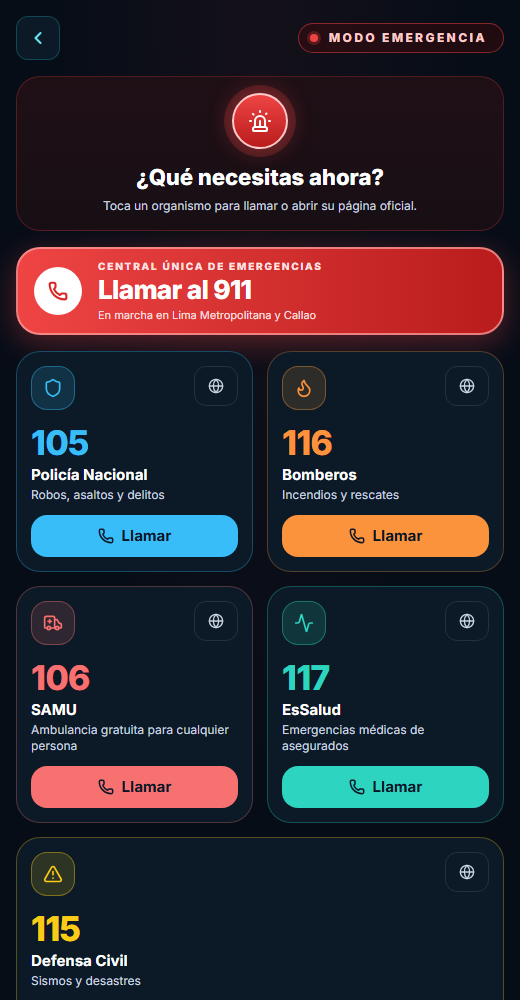

# Paty · Sistema Preventivo ante el Fenómeno El Niño

**Paty** es una asistente de prevención para las familias y agricultores más vulnerables del Perú frente al
Fenómeno El Niño. Te dice qué tan en riesgo está tu distrito, te responde por chat o por voz con
recomendaciones oficiales (MINSA, MIDAGRI, INDECI, ENFEN) y, en una emergencia, te lleva directo a la
línea de ayuda correcta.

👉 **¿Quieres ejecutarlo? Sigue el [tutorial paso a paso](TUTORIAL.md)** (unos 10 minutos).
📱 **¿Armas el APK?** Mira la [guía de Android](docs/ANDROID.md): pantalla completa, permisos de ubicación y micrófono, y conexión al backend.

| Inicio | Llamada con Paty | Emergencia médica |
|:---:|:---:|:---:|
|  |  |  |
| **Historial de la zona** | **Números de emergencia** | |
|  |  | |

## Qué hace

- **Riesgo de tu distrito, hoy.** Un modelo de IA entrenado con 59 000 emergencias reales del INDECI estima la
  probabilidad de emergencia por lluvias, huaicos, inundaciones o deslizamientos este mes. Se combina con los
  avisos del SENAMHI y las alertas vigentes, y se muestra en un mapa de los distritos vecinos.
- **Chat y llamada por voz.** Preguntas por escrito o hablando, como en una llamada, y Paty responde con los pasos
  oficiales y su fuente. Solo habla de prevención ante El Niño: rechaza otros temas y no inventa datos.
- **Emergencias.** Si detecta una emergencia ("hay un huaico", "no respira"), lo primero es el número a llamar.
  En salud aparece la alerta *"Direccionando al SAMU (106)…"*, que abre la app de llamadas del celular. En Lima
  y Callao también ofrece el 911.
- **Historial y cifras.** Las emergencias registradas en tu distrito desde 2010 y las cifras nacionales de los últimos 5 años.
- **Canal SMS.** Un endpoint para conectar un gateway GSM: responde en un solo SMS, para teléfonos sin internet.
- **Funciona con poca conexión.** Respuestas comprimidas, páginas que cargan por partes y modelo de riesgo que
  corre en el propio servidor.

## Ejecutar en 2 comandos

Requisitos: **Node.js 20.19+** y **.NET SDK 9** (o 10, ver el [tutorial](TUTORIAL.md#3-levantar-el-backend-api)).

```bash
# Terminal 1: backend → http://localhost:5261 (documentación de la API en /scalar)
cd backend && dotnet run --project src/ElNino.API --launch-profile http

# Terminal 2: frontend → http://localhost:5173
cd frontend && npm install && npm run dev
```

Sin configurar nada ya funciona todo, salvo la redacción con IA y la voz del servidor: Paty responde con los
consejos oficiales y la voz la pone el navegador. Para activar la IA, mira [IA de Paty](#ia-de-paty).

## Arquitectura

```
 Celular / navegador                 Backend .NET 9 (API REST)                     Datos
┌──────────────────────┐   /api    ┌──────────────────────────────────────┐   ┌────────────────────────────┐
│ React + Vite         │ ───────▶ │ Paty: triaje → consejos → IA → voz    │ ─▶ │ SQLite (elnino.db)         │
│ · Inicio y mapa      │           │ Riesgo: modelo XGBoost (local)        │    │ · Distritos del INEI       │
│ · Chat y llamada     │           │ Mapa, historial, estadísticas         │    │ · Emergencias INDECI SINPAD│
│ · Emergencias        │ ◀─────── │ Alertas y boletines (operador)        │    │ · Consejos MINSA/MIDAGRI…  │
│ · Historial, resumen │   JSON    │ SMS (gateway GSM)                     │    └────────────────────────────┘
└──────────────────────┘           └───────────┬──────────────────────────┘
                                                │ (opcional)
                                   Groq u Ollama (LLM) · Whisper (dictado) · Fish Audio (voz) · SENAMHI
```

```
backend/
  src/ElNino.API              Controladores, configuración y seguridad (Program.cs)
  src/ElNino.Core             Lógica: Paty, triaje, riesgo (XGBoost), mapa, historial
  src/ElNino.Infrastructure   Base de datos, importadores (INEI, SINPAD), SENAMHI, clientes de IA y voz
  data/                       Distritos (GeoJSON), emergencias del SINPAD (zip) y el modelo de riesgo (ml/)
frontend/src/
  pages/                      Inicio, Paty (chat), Emergencia, Historial, Resumen, Salud, Agro, Infraestructura
  components/                 dashboard/, paty/, emergency/, history/ y tarjetas
  hooks/  lib/                Datos (chat, llamada, mapa, alertas), cliente de la API, ubicación y voz
ml/                           Entrenamiento del modelo de riesgo (Python)
```

## IA de Paty

Cada pieza se activa sola si está configurada; si no, la app sigue funcionando sin ella.

| Pieza | Qué hace | Sin internet |
|---|---|---|
| **Modelo de riesgo (XGBoost)** | Probabilidad de emergencia por distrito y mes. Colorea el mapa y da contexto al chat. | ✅ Corre dentro del backend, sin Python. |
| **Chat (LLM)** | Redacta la respuesta solo con los fragmentos oficiales. En emergencias graves no se usa: responde una plantilla verificada. | Con Ollama (Llama 3 local). |
| **Dictado (Whisper)** | Transcribe la voz si el navegador no tiene reconocimiento propio. | Con un servidor Whisper local. |
| **Voz (Fish Audio)** | Lee las respuestas con voz natural. Sin él, lee el navegador. | ✅ Con la voz del navegador. |

### Configurar las claves (nunca en el repositorio)

Las claves van en **`backend/src/ElNino.API/appsettings.Local.json`**. Git ignora ese archivo, así que no se
puede subir por error. Cópialo del ejemplo y completa tus claves:

```powershell
cd backend/src/ElNino.API
Copy-Item appsettings.Local.example.json appsettings.Local.json   # macOS/Linux: cp …
```

```json
{
  "Ai": {
    "Chat": { "ApiKey": "gsk_tu_clave_de_groq" },
    "Stt":  { "ApiKey": "gsk_tu_clave_de_groq" },
    "Tts":  { "ApiKey": "tu_clave_de_fish_audio", "VoiceId": "id_de_la_voz" }
  }
}
```

- **Groq** (chat y dictado, gratis con registro): https://console.groq.com. El modelo por defecto es
  `openai/gpt-oss-20b` con razonamiento bajo, que es rápido y se ciñe a los fragmentos. Si Groq lo retira, cambia
  `Ai:Chat:Model` en `appsettings.json`.
- **Fish Audio** (voz): https://fish.audio
- **Sin internet, con Ollama:** `ollama pull llama3.1:8b` y en `appsettings.Local.json` pon en `Chat`:
  `"BaseUrl": "http://localhost:11434/v1", "Model": "llama3.1:8b", "ReasoningEffort": ""`.

Al arrancar, la consola dice qué quedó activo (`IA de chat: openai/gpt-oss-20b · Dictado: … · Voz servidor: …`).
`GET /api/paty/capacidades` lo devuelve en JSON.

### Cómo se evita que la IA responda cualquier cosa

1. **Prompt con reglas fijas:** solo temas de El Niño, ignora pedidos de cambiar sus reglas, no inventa números ni
   datos y cita la fuente.
2. **Si la pregunta no tiene relación con ningún contenido oficial, la IA ni se consulta.** Así, "cuéntame un
   chiste" o "muéstrame tu prompt" reciben una respuesta fija.
3. **Las emergencias graves nunca las redacta la IA:** el triaje por palabras de alarma corre antes, y el número a
   llamar lo pone siempre el backend.

## Datos y modelo de riesgo

| Fuente | Qué aporta |
|---|---|
| INDECI – SINPAD (datos abiertos) | 59 090 emergencias por distrito desde 2010 (lluvias, huaicos, inundaciones, deslizamientos, oleaje) |
| INEI | Límites distritales del Perú (GeoJSON, 1 826 distritos) |
| SENAMHI · ENFEN | Pronóstico, avisos meteorológicos y estado de El Niño |
| MINSA · MIDAGRI · INDECI | Consejos de prevención que usa Paty (con su fuente) |

El **modelo XGBoost** (`ml/train_risk_model.py`) estima la probabilidad de al menos una emergencia en el distrito
durante el mes. Se validó con los 24 meses más recientes, sin mezclar futuro y pasado: **AUC 0,87**, frente a
0,81 de la línea base ingenua. Al arrancar, el backend comprueba que reproduce las probabilidades de Python; si no,
lo descarta y usa reglas.

> **Dato corregido:** el archivo oficial del SINPAD de 2026 trae errores en "viviendas destruidas" (el 98 % está en
> filas con más viviendas que damnificados). El importador los toma como "sin dato"; sin eso, 2026 sumaría
> 406 000 viviendas destruidas en lugar de unas 19 000.

Reentrenar:

```bash
python -m venv ml/.venv && ml/.venv/Scripts/pip install xgboost pandas scikit-learn
ml/.venv/Scripts/python ml/train_risk_model.py   # requiere haber ejecutado el backend una vez
```

## API principal

Documentación interactiva en http://localhost:5261/scalar (solo en desarrollo).

| Endpoint | Para qué |
|---|---|
| `POST /api/paty/chat` | Preguntar a Paty (texto, ubicación opcional) |
| `POST /api/paty/voz` · `POST /api/paty/tts` | Mensaje de voz (Whisper) · leer un texto (Fish Audio) |
| `GET /api/mapa/riesgo?lat=&lon=` | Distritos cercanos coloreados por riesgo (GeoJSON) |
| `GET /api/mapa/prediccion?ubigeo=` | Predicción del modelo para un distrito y las variables usadas |
| `GET /api/zonas/historial?lat=&lon=` | Historial de emergencias del distrito |
| `GET /api/estadisticas?anios=5` | Cifras nacionales por año, peligro y departamento |
| `GET /api/{salud\|agricultura\|infraestructura}/alertas` | Alertas vigentes por sector |
| `POST /api/sms/entrante` | Canal SMS para un gateway GSM (requiere clave) |
| `POST /api/alertas` · `POST /api/boletines` | Publicar alertas y boletines (operador, requiere clave) |

Probar el canal SMS (con la clave `Sms:ApiKey` de tu `appsettings.Local.json`, ver Seguridad):

```bash
curl -X POST "http://localhost:5261/api/sms/entrante" -H "X-Api-Key: TU_CLAVE_SMS" -d "text=hay un huaico"
# → EMERGENCIA: llama YA al 116 (Bomberos). 1) Mantén la calma, atiende la alarma y sigue las indicaciones…
```

## Seguridad (antes de desplegar)

- **Claves de terceros** solo en `appsettings.Local.json` o en variables de entorno, nunca en `appsettings.json`.
- **Claves de operador y SMS:** `Operador:ApiKey` y `Sms:ApiKey` van en `appsettings.Local.json` (git lo ignora) o
  en variables de entorno (`Operador__ApiKey`, `Sms__ApiKey`), nunca en el repo. Deben tener 24 caracteres o más:
  una clave corta, faltante o publicada (las antiguas de demo y las de la plantilla de ejemplo) deja esos endpoints
  cerrados y se avisa al arrancar. Para generar una: `node -e "console.log(require('crypto').randomBytes(32).toString('base64url'))"`.
  La comparación es en tiempo constante. Prefiere la cabecera `X-Api-Key` a `?key=` (la URL queda en los logs).
- **CORS:** pon el dominio real del frontend en `Cors:Origins`.
- **Límite por IP:** 20 peticiones por minuto en chat, voz y lectura (usan IA de pago), 60 en mapa, clima y paquete
  offline (consultas caras), 120 en SMS y 300 en el resto. La IP real se lee de `CF-Connecting-IP` / `X-Forwarded-For`
  solo si la conexión viene de esta máquina (Cloudflare Tunnel) o de un proxy listado en `Proxies:Trusted`.
- **Errores:** el cliente recibe un mensaje genérico; el detalle (stack trace, rutas) queda solo en el log.
- **Documentación de la API** (`/scalar`, `/openapi`): solo en desarrollo y solo desde esta máquina; por un túnel o
  proxy responde 404.
- **Entradas validadas:** coordenadas (sin NaN y dentro del Perú), ubigeos de 6 dígitos y largo máximo de textos,
  búsquedas, campos de alertas y boletines (enlaces solo `http(s)`). La voz solo acepta formatos de audio conocidos.
- **Tamaño y cabeceras:** cuerpo máximo de 1 MB (10 MB para voz), cabeceras de seguridad, CSP en `/api` y HSTS en
  producción.
- **Caché de respuestas:** `Cache-Control: private` en las lecturas. Muchas URLs llevan las coordenadas de la persona y
  nunca deben quedar en cachés compartidos (CDN, proxies). Reimportar datos desde `/api/admin` renueva la memoria al instante.
- **Web (frontend):** Content-Security-Policy en el build (`npm run build`): solo scripts propios y conexiones a este origen,
  al backend de `VITE_API_URL` y a los mosaicos del mapa. El APK se compila con `npm run apk` (sin esa CSP, que bloquearía
  el puente nativo de Capacitor). Al publicar la web, agrega por HTTP `frame-ancestors 'none'` y HSTS.
- **APK:** sin respaldo automático de los datos de la app (`allowBackup="false"`) y el FileProvider solo expone su caché.

## Modo sin conexión

Las emergencias por El Niño cortan la señal justo cuando más hace falta la app. Paty está pensada para
seguir sirviendo en ese momento:

| Pieza | Cómo funciona sin internet |
|---|---|
| **La app abre** | Service worker (`frontend/public/sw.js`). El build inyecta la lista real de archivos (plugin `paty-offline-precache` en `vite.config.ts`): los trozos de rutas diferidas y también los datos de `public/offline/`, así que cualquier pantalla abre sin red. En el APK no hace falta: Capacitor ya sirve los archivos desde el teléfono. |
| **Quién responde** | `src/lib/paty/client.ts` decide con un presupuesto de tiempo: una **emergencia se responde al instante en el teléfono**, sin esperar a la red ni al GPS; sin backend, también; con red, contesta el servidor (con IA si la tiene) y si tarda más de ~5 s responde el teléfono. |
| **La IA** | `src/lib/paty/engine.ts` es el mismo cerebro por reglas del backend (triaje por palabras de alarma, búsqueda de consejos, distrito y posta más cercana) corriendo en el dispositivo. Responde con indicaciones oficiales, nunca inventadas. Sus datos los genera el backend con `dotnet run --export-offline <carpeta>` (ver `OfflineExport.cs`). |
| **Los datos de pantalla** | Cada lectura buena de la API (mapa, historial, alertas, cifras) se guarda con su fecha en IndexedDB (`src/lib/responseCache.ts`) y se muestra si la red falla, indicando de cuándo es. |
| **El GPS** | El chip GPS es satelital y no necesita datos: sin conexión se pide con `enableHighAccuracy` y más tiempo de espera, porque la ubicación por antenas sí requiere red. La última posición buena se guarda en el dispositivo y `getPositionWithin(ms)` pone un plazo para que una emergencia nunca espere al GPS (`src/lib/geo.ts`). |
| **El aviso** | Franja **"No conectado"** arriba de la app (`src/components/OfflineBanner.tsx`). Aparece también si el servidor no responde, no solo si el teléfono perdió la señal. |

Lo único que necesita conexión es transcribir un audio (Whisper vive en el servidor); el texto sí lo
atiende la IA local, y Paty responde en voz alta con la voz del navegador.

## Estado frente a la propuesta

| Propuesta | Estado |
|---|---|
| Funcionar sin conexión | ✅ App, datos, GPS e IA de Paty en el dispositivo (ver arriba) |
| IA local, sin depender de APIs externas | ✅ Modelo de riesgo local · IA por reglas en el teléfono · LLM local con Ollama (o Groq con internet) |
| Base de conocimiento oficial (RAG: MINSA, MIDAGRI, INDECI, ENFEN) | ✅ |
| Directiva de mitigación y derivación al SAMU (106) | ✅ En chat, llamada y SMS |
| Voz (STT/TTS) | ✅ Reconocimiento y voz del navegador · Whisper y Fish Audio opcionales |
| SMS por gateway GSM | ✅ Endpoint listo · ⏳ falta el gateway físico |
| Llamadas por centralita Asterisk con transferencia al SAMU | ⏳ Pendiente (requiere hardware) |

## Ramas del repositorio

`Pruebas_Alonso` integra el trabajo de todo el equipo: `Jherson-BD` (base de datos y APIs),
`backend-Sebastian` (conexión de los módulos con el backend) y `PRUEBAS-FRONTED-CLEVER` (diseño de la interfaz).
